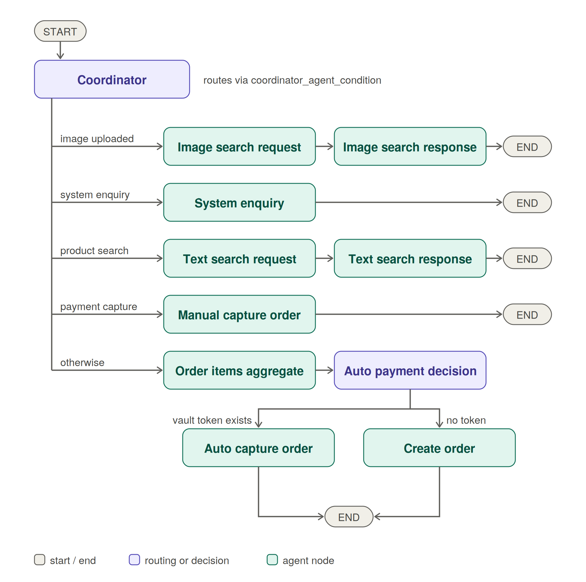

## Penny
 
Not everyone wants an AI holding their wallet. Penny finds products from text or photos. You pay on PayPal yourself, or let her check out with a payment method you can revoke anytime.

## Penny modes
 
Penny works in two modes. The difference is who performs the checkout.
 
| | **Shop with me** | **Buy for me** |
| --- | --- | --- |
| **Who checks out** | You | Penny |
| **How payment happens** | You approve the order yourself on the PayPal login screen | Penny captures the PayPal order automatically using your saved (vaulted) payment method |
| **Best for** | Trying Penny out, larger purchases, anyone who wants full control | Routine purchases and repeat buyers who have already linked PayPal |
| **Requires** | A PayPal account | A PayPal account with a saved payment token |
 
**Shop with me:** Penny finds the products and creates the order. You are sent to PayPal, log in, and approve the payment yourself. Penny then confirms the capture.
 
**Buy for me:** If you have a saved PayPal payment token, Penny creates the order and captures it without sending you to the PayPal login screen. If no token exists, Penny falls back to the Shop with me flow.


## Enabling Buy for me: saving a PayPal payment method
 
Buy for me only works after a user saves a PayPal payment method, called a **vault token**. Three authenticated endpoints manage it. Each one requires the signed-in user's bearer token and only acts on that user's own token.
 
| Method | Endpoint | What it does |
| --- | --- | --- |
| `POST` | `/setup-token` | Creates a PayPal vault setup token for the current user. The frontend uses it to send the user to PayPal to approve saving their payment method. |
| `DELETE` | `/own` | Deletes the current user's saved vault token. Buy for me turns off and Penny goes back to Shop with me. |
| `POST` | `/setup-token-exchange` | Exchanges the approved setup token for a permanent vault payment token and saves it for the user. |
 


## Features
 
- **Text product search** powered by [Channel3](https://trychannel3.com) product data
- **Image product search:** upload a photo and Penny finds similar products, with optional price and gender filters
- **PayPal checkout** with order creation and capture (sandbox)
- **Two checkout modes** so users decide how much control to hand over
- **Intent-based routing** through a multi-agent state graph
- **System enquiries:** ask Penny how she works


## How it works
 
Every message enters a coordinator agent that decides where to send it. The diagram below shows the full agent flow.
 
<p align="center">
  
</p>


### Routing rules
 
1. **Image uploaded:** goes to image search, regardless of the typed message.
2. **System enquiry:** goes to the system enquiry agent.
3. **Product search:** goes to text search request and response.
4. **Payment capture:** goes to manual capture, the final step of Shop with me.
5. **Anything else:** goes to the order flow (aggregate items, then decide how to pay).


### The order flow and the two modes
 
After items are aggregated, the **auto payment decision** step checks whether the user has a saved PayPal vault token:
 
- **Token exists:** the **auto capture** agent captures the order. This is **Buy for me**.
- **No token:** the **create order** agent creates the order and hands the user to PayPal to approve it. When they return, the **manual capture** agent completes the payment. This is **Shop with me**.


### Agent nodes
 
| Diagram label | Node name |
| --- | --- |
| Coordinator | `coordinator_agent` |
| Image search request / response | `search_product_with_image_request_agent`, `search_product_with_image_response_agent` |
| System enquiry | `system_enquiry_agent` |
| Text search request / response | `search_product_request_agent`, `search_product_response_agent` |
| Manual capture order | `manual_capture_order_agent` |
| Order items aggregate | `order_items_aggregate_agent` |
| Auto payment decision | `auto_payment_decision_agent` |
| Auto capture order | `auto_capture_paypal_order_agent` |
| Create order | `order_create_agent` |


## Tech stack
 
- **Orchestration:** LangGraph state graph with async agents (Python)
- **LLM:** DeepSeek
- **Product search:** Channel3 SDK (text and image search)
- **Payments:** PayPal Orders API and vaulted payment tokens (sandbox)
<!-- - **Frontend:** React -->

### Prerequisites
 
- Python 3
- A PayPal developer account with sandbox credentials
- A Channel3 API key
- A DeepSeek API key


### Setup
 
```bash
git clone https://github.com/Princeigwe/penny
cd penny
cd api
 
python -m venv env
source env/bin/activate
 
pip install -r requirements.txt
```


### Configure environment variables
 
Create a `.env` file in the project root:
 
```env
ENVIRONMENT=development
DEEPSEEK_API_KEY=xxxxxxxx
CHANNEL3_API_KEY=xxxxxxxx
PAYPAL_BUSINESS_SANDBOX_CLIENT_ID=xxxxxxxx
PAYPAL_BUSINESS_SANDBOX_SECRET_KEY=xxxxxxxx
```
 
### Run
 
```bash
docker compose up -d

cd api
python -m venv env
source env/bin/activate
uvicorn main:app --reload
```

## API documentation

Once the server is running, interactive API docs are available at:

- **Swagger UI:** [http://localhost:8000/docs](http://localhost:8000/docs)


## Contributors

- [Steve Mogbo](https://www.linkedin.com/in/steve-mogbo) - Product
- [Prince Igwenagha](https://www.linkedin.com/in/prince-igwenagha) - Backend & AI
- [James Asaolu](https://www.linkedin.com/in/james-asaolu) - Frontend
 
